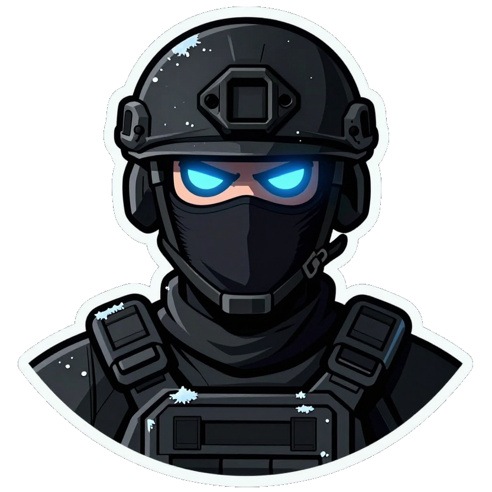
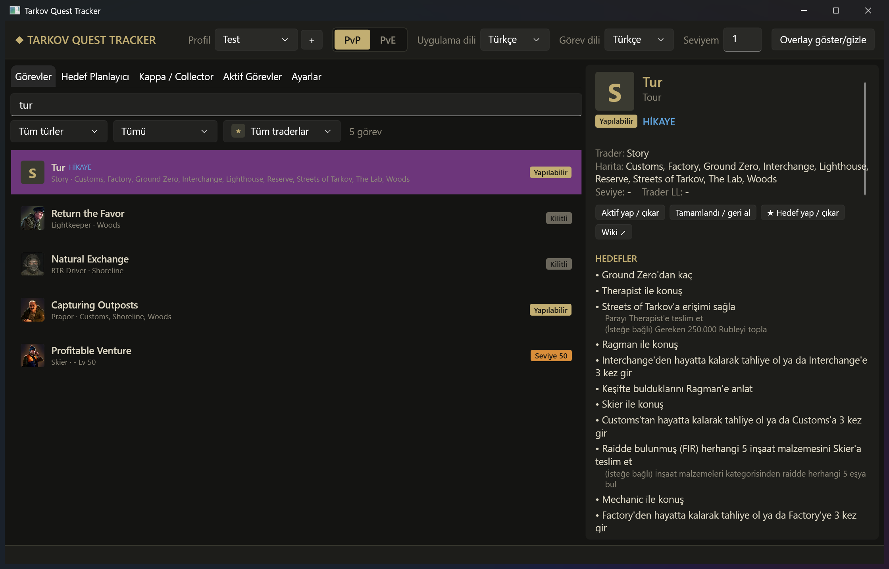
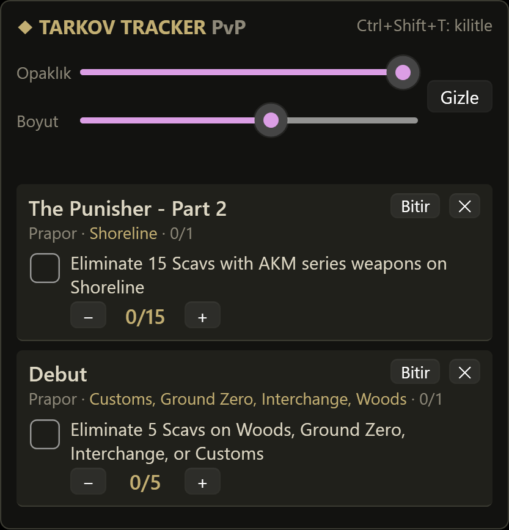

<p align="center">
  
</p>

<h1 align="center">EFT Quest Helper</h1>

<p align="center">
  A desktop quest tracker and planner for <b>Escape from Tarkov</b> — with an always-on-top overlay.<br>
  <b>English</b> · <a href="README.tr.md">Türkçe</a> · <a href="README.ru.md">Русский</a>
</p>

<p align="center">
  <a href="https://github.com/ugurturna/eft_quest_helper/releases/tag/v0.0.1">
    
  </a><br>
  <a href="https://github.com/ugurturna/eft_quest_helper/releases/tag/v0.0.1">https://github.com/ugurturna/eft_quest_helper/releases/tag/v0.0.1</a><br>
  🌐 <b>Website:</b> <a href="https://ugurturna.github.io/eft_quest_helper/">https://ugurturna.github.io/eft_quest_helper/</a>
</p>

---

## Ban risk

> [!TIP]
> **No known ban risk.** EFT Quest Helper is a normal, separate Windows application. It does **not** read or write game memory, does **not** inject anything into the game, does **not** read game files or logs, does **not** send input to the game and does **not** talk to the game's servers. The overlay is just an ordinary window kept on top of the screen (like a sticky note), and the hotkeys use the standard Windows `RegisterHotKey` API.

> [!CAUTION]
> **Use it at your own risk. This project is not affiliated with or endorsed by Battlestate Games, and BSG can change its rules at any time. If BSG ever states that tools like this are not allowed, stop using it.**

---

<p align="center">
  
</p>

## Features

- **All quests in one place** — ~870 quests: trader (side) quests, story chapters and event quests, with objectives, required items, rewards, guides and notes.
- **Prerequisite chains** — every quest knows what it needs and what it unlocks.
- **Goal planner** — pick a goal (e.g. *The Punisher – Part 3* or *Collector*) and see the whole chain in order, what you can do right now and what is left.
- **Kappa / Collector path** — progress bar, available Kappa quests **grouped by map** so you can do several in one raid, and quests waiting for your level.
- **Active quests + overlay** — the quests you are doing right now appear in a small tracker on the right edge of the screen, with objective checkboxes and kill/item counters.
- **Activating a quest completes its chain** — set *Punisher Part 5* active and Parts 1–4 are marked done automatically (one-click undo).
- **PvP and PvE** — separate progress for each mode; PvE-specific differences (levels, objectives) are shown.
- **Search in English and Turkish** — tolerant of typos and Turkish characters (`punisher 3`, `punişır 3`, `cezalandırıcı`).
- **Two languages, independently** — app language (menus) and quest language (quest text) can differ, e.g. Turkish app with English quests. All story chapters are translated to Turkish.
- **Profiles** — several players on one PC, each with their own progress and settings.
- **Event quests** — active events are listed; past events can be shown in Settings.
- **Fast** — lists load page by page while you scroll.

### Overlay



- Docked to the right edge, **moves only up/down** (drag the header).
- Adjustable **opacity**, **size** (60–200 %, also <kbd>Ctrl</kbd> + mouse wheel) and **width**.
- Two views: **titles only** or **title + details**.
- <kbd>Ctrl</kbd>+<kbd>Shift</kbd>+<kbd>T</kbd> — lock the overlay (clicks go through to the game) / unlock.
- <kbd>Ctrl</kbd>+<kbd>Shift</kbd>+<kbd>H</kbd> — show / hide the overlay.
- It never takes focus away from the game.

> [!NOTE]
> Run Tarkov in **Borderless** or **Windowed** mode. Windows cannot draw other windows over a game in exclusive fullscreen.

<br clear="right">

## Download & run

**Download release (recommended):** [v0.0.1 Release](https://github.com/ugurturna/eft_quest_helper/releases/tag/v0.0.1)

Requirements: **Windows 10/11** and the **[.NET 10 SDK](https://dotnet.microsoft.com/download)** (to build) or .NET 10 Desktop Runtime (to run a published build).

```powershell
git clone git@github.com:ugurturna/eft_quest_helper.git
cd eft_quest_helper
dotnet run --project TarkovQuestTracker
```

Build a standalone folder you can copy anywhere:

```powershell
dotnet publish TarkovQuestTracker -c Release -r win-x64 --self-contained true -o publish
# start publish\TarkovQuestTracker.exe
```

## Where is my progress stored?

Everything is stored locally, nothing is uploaded:

```
%APPDATA%\TarkovQuestTracker\
  app.json                      last used profile
  profiles\<name>\settings.json overlay, languages, hotkeys
  profiles\<name>\progress_pvp.json
  profiles\<name>\progress_pve.json
```

Progress is saved on every click. Use **Settings → Export / Import** to back it up or move it to another PC. Set the `TARKOV_TRACKER_HOME` environment variable to keep the data somewhere else (portable use).

Hotkeys can be changed in `settings.json` (`clickThroughHotkey`, `toggleOverlayHotkey`, e.g. `"Ctrl+Alt+F9"`).

## Quest data

Quest data lives in `data/` and is built by the scripts in `tools/scraper/` (Python 3.12, standard library only):

| Command | What it does |
|---|---|
| `python tools/scraper/scrape_wiki.py` | Downloads all quests from the [EFT Fandom wiki](https://escapefromtarkov.fandom.com/) → `data/tasks_en.json` (`--refresh` ignores the local cache) |
| `python tools/scraper/fetch_tarkovdev.py` | Downloads extra data from [tarkov.dev](https://tarkov.dev/) (Kappa flags, levels, missing prerequisites, Turkish names) |
| `python tools/scraper/merge.py` | Merges tarkov.dev into the wiki data and writes `data/diff_report.md` showing where the two sources disagree |
| `python tools/scraper/build_translations.py tr` | Merges the hand-written translations in `tools/translations/tr/` into `data/tasks_tr.json` |

Every quest records where each field came from (`sources`), so you can tell wiki data from tarkov.dev data.

### Translating

Translations are plain JSON files, one per quest, in `tools/translations/<lang>/`. They survive re-scraping. Copy an existing file (e.g. `tools/translations/tr/story/tour.json`), translate `name`, `objectives[].text`, `objectives[].details` and `guide`, then run `build_translations.py`. The script reports missing or mismatched objectives.

App (menu) texts are in `TarkovQuestTracker/Strings/Strings.<lang>.xaml`.

## Project structure

```
TarkovQuestTracker/          WPF app (.NET 10): windows, overlay, view models, UI strings
TarkovQuestTracker.Core/     quest models, data loading, search, prerequisite graph, profiles/progress
tests/                       xUnit tests (planner, search, profiles, real data sanity checks)
tools/scraper/               data scripts (wiki, tarkov.dev, merge, translations)
tools/translations/          hand-written translations
tools/make_icon.ps1          builds the .ico from a PNG
data/                        generated quest data shipped with the app
```

Run the tests with `dotnet test`.

## Credits & legal

- Quest data: [Escape from Tarkov Wiki (Fandom)](https://escapefromtarkov.fandom.com/), content available under [CC BY-SA 3.0](https://creativecommons.org/licenses/by-sa/3.0/), and [tarkov.dev](https://tarkov.dev/).
- *Escape from Tarkov*, trader names and trader portraits are trademarks/property of **Battlestate Games**. They are used here only to identify in-game content. This is a non-commercial fan project.
- Free code signing provided by [SignPath.io](https://signpath.io), certificate by [SignPath Foundation](https://signpath.org).
- Licensed under the [MIT License](LICENSE).
