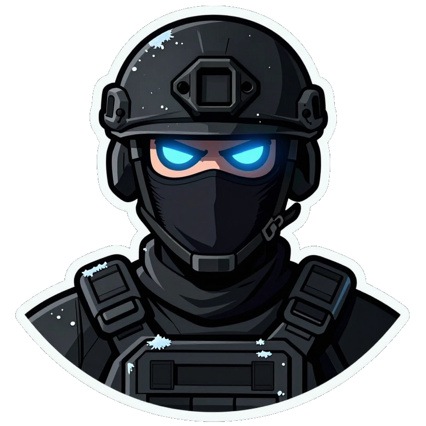
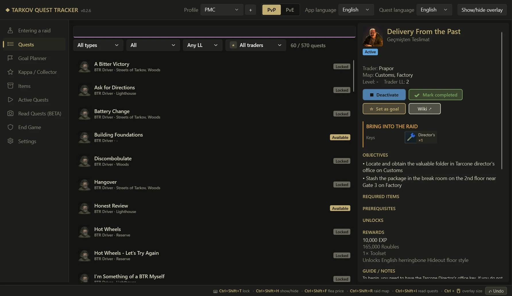
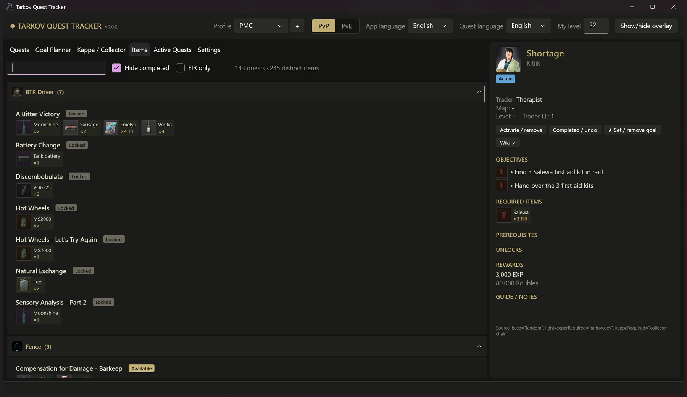
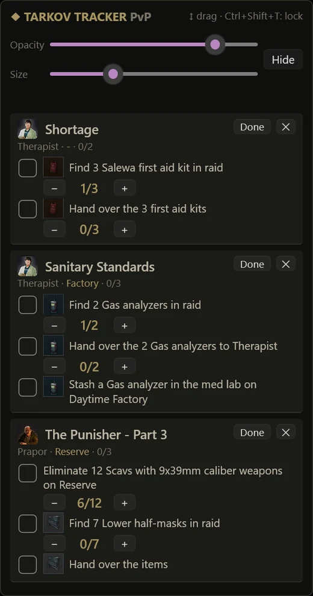

<p align="center">
  
</p>

<h1 align="center">EFT Quest Helper</h1>

<p align="center">
  Десктопный трекер и планировщик заданий для <b>Escape from Tarkov</b> — с оверлеем поверх всех окон.<br>
  <a href="README.md">English</a> · <a href="README.tr.md">Türkçe</a> · <b>Русский</b>
</p>

<p align="center">
  <a href="https://github.com/ugurturna/eft_quest_helper/releases/latest">
    
  </a><br>
  <a href="https://github.com/ugurturna/eft_quest_helper/releases/latest">https://github.com/ugurturna/eft_quest_helper/releases/latest</a><br>
  🌐 <b>Веб-сайт:</b> <a href="https://ugurturna.github.io/eft_quest_helper/">https://ugurturna.github.io/eft_quest_helper/</a>
</p>

---

## Риск бана

> [!TIP]
> **Известного риска бана нет.** EFT Quest Helper — обычное отдельное приложение Windows. Оно **не читает и не изменяет** память игры, **ничего не внедряет** в игру, **не читает** файлы и логи игры, **не отправляет** в игру нажатия клавиш или мыши и **не обращается** к серверам игры. Оверлей — это обычное окно, которое держится поверх экрана (как стикер), а горячие клавиши используют стандартный API Windows `RegisterHotKey`.

> [!CAUTION]
> **Используйте на свой страх и риск. Проект не связан с Battlestate Games и не одобрен ими; BSG может изменить свои правила в любой момент. Если BSG объявит, что подобные инструменты запрещены, прекратите им пользоваться.**

---

<p align="center">
  
</p>

## Возможности

- **Все задания в одном месте** — ~870 заданий: задания торговцев, сюжетные главы и ивентовые задания, с целями, нужными предметами, наградами, гайдами и заметками.
- **Предметы для заданий с иконками** — какому торговцу какие предметы нужны и для каких заданий: с иконками, количеством и пометкой «найдено в рейде» (FIR) (см. [Предметы для заданий](#предметы-для-заданий)).
- **Цепочки требований** — у каждого задания видно, что для него нужно и что оно открывает.
- **Планировщик целей** — выберите цель (например, *The Punisher – Part 3* или *Collector*) и увидите всю цепочку по порядку, что можно сделать прямо сейчас и что осталось.
- **Путь к Kappa / Collector** — задания, которые действительно нужны для Kappa: *Collector* и вся цепочка его требований. Шкала прогресса, доступные задания **сгруппированы по картам** (можно сделать несколько за один рейд), а также задания, ждущие нужного уровня.
- **Активные задания + оверлей** — задания, которые вы выполняете сейчас, отображаются в небольшом трекере у правого края экрана, с галочками целей, счётчиками убийств/предметов и иконками предметов.
- **Активация задания закрывает его цепочку** — сделайте *Punisher Part 5* активным, и части 1–4 автоматически отметятся выполненными (отмена в один клик).
- **PvP и PvE** — отдельный прогресс для каждого режима; показываются отличия PvE (уровни, цели, предметы).
- **Поиск на английском и турецком** — устойчив к опечаткам и турецким символам.
- **Два независимых языка** — язык приложения (меню) и язык заданий (названия заданий и предметов) можно выбирать отдельно. Сейчас доступны английский и турецкий.
- **Профили** — несколько игроков на одном ПК, у каждого свой прогресс и настройки.
- **Ивентовые задания** — текущие ивенты в списке; прошедшие можно включить в настройках.
- **Быстро** — списки подгружаются постранично при прокрутке.

### Предметы для заданий

<p align="center">
  
</p>

Вкладка **Items** отвечает на вопрос «что сохранить для заданий?»:

- Сгруппировано **по торговцам**, затем **по заданиям**; каждый предмет — небольшая карточка с **иконкой**, коротким названием, **количеством** и пометкой **FIR**, если его нужно найти в рейде. Наведите курсор, чтобы увидеть полное название.
- Если цель принимает несколько предметов (например, *любые 3 медицинских предмета*), показывается первый и **+N**; во всплывающей подсказке — список вариантов.
- **Поиск** по предмету (`Salewa`, `GPU`, `Tushonka`…) покажет все задания, где он нужен.
- Фильтры **Hide completed** (включён по умолчанию) и **FIR only**; вверху видно, сколько заданий и разных предметов осталось.
- Клик по названию задания открывает его в панели деталей.

Иконки предметов есть и **внутри заданий**: цели «найти / передать / спрятать» показывают иконку предмета в деталях задания, на карточках *Active Quests* и в оверлее, а панель деталей показывает нужные предметы карточками. Названия предметов — на языке заданий (английский или турецкий).

### Оверлей



- Прикреплён к правому краю, **двигается только вверх/вниз** (перетаскивайте заголовок).
- Настраиваемые **прозрачность**, **размер** (60–200 %, также <kbd>Ctrl</kbd> + колесо мыши) и **ширина**.
- Два вида: **только названия** или **название + детали**.
- Цели с предметами показывают **иконку предмета** — лут узнаётся с первого взгляда прямо в рейде.
- <kbd>Ctrl</kbd>+<kbd>Shift</kbd>+<kbd>T</kbd> — заблокировать оверлей (клики проходят в игру) / разблокировать.
- <kbd>Ctrl</kbd>+<kbd>Shift</kbd>+<kbd>H</kbd> — показать / скрыть оверлей.
- Никогда не забирает фокус у игры.

> [!NOTE]
> Запускайте Tarkov в режиме **Borderless (Без рамки)** или **Windowed (В окне)**. Windows не может рисовать другие окна поверх игры в эксклюзивном полноэкранном режиме.

<br clear="right">

## Скачать и запустить

**Скачать последний релиз (рекомендуется):** [Релизы](https://github.com/ugurturna/eft_quest_helper/releases/latest) → `TarkovQuestTracker-vX.Y.Z-win-x64.zip`

Распакуйте zip в любую папку и запустите `TarkovQuestTracker.exe`. Ничего устанавливать не нужно: .NET уже включён. Папка `data` должна лежать рядом с exe — в ней данные заданий, иконки предметов и ваш прогресс.

### Предупреждение «Система Windows защитила ваш компьютер»

Exe пока не подписан цифровой подписью, поэтому при первом запуске Microsoft Defender SmartScreen может показать **«Система Windows защитила ваш компьютер — Неизвестный издатель»**. Для новых неподписанных open-source приложений это нормально; предупреждение исчезает по мере того, как приложением пользуется больше людей.

> [!IMPORTANT]
> **Каждый релиз отправляется в Microsoft на проверку на вредоносное ПО.** Проверка занимает **3–5 рабочих дней**, поэтому новый релиз может показывать это предупреждение, пока проверка не завершится.

Чтобы всё равно запустить: **Подробнее** → **Выполнить в любом случае**.

Если хотите сначала проверить: весь исходный код находится в этом репозитории, а каждый релиз собирается через [GitHub Actions](.github/workflows/release.yml) из коммита с тегом. Также можно проверить zip на [VirusTotal](https://www.virustotal.com/) перед запуском.

### Обновление

Прогресс хранится в `data\profiles` рядом с exe. Распакуйте новую версию в новую папку и скопируйте туда `data\profiles`, либо используйте **Настройки → Экспорт** в старой версии и **Импорт** в новой.

## Где хранится прогресс?

Всё хранится локально, ничего никуда не отправляется. Если рядом с exe есть папка `data` (zip релиза, publish или собранное приложение), используется она:

```
data\
  app.json                          последний профиль
  profiles\<имя>\settings.json      оверлей, языки, горячие клавиши
  profiles\<имя>\progress_pvp.json
  profiles\<имя>\progress_pve.json
```

Если папки `data` рядом с exe нет, те же файлы пишутся в `%APPDATA%\TarkovQuestTracker\`. Чтобы хранить их в другом месте, задайте переменную окружения `TARKOV_TRACKER_HOME`.

Прогресс сохраняется при каждом клике. Для резервной копии или переноса на другой ПК используйте **Настройки → Экспорт / Импорт**.

Горячие клавиши меняются в `settings.json` (`clickThroughHotkey`, `toggleOverlayHotkey`, например `"Ctrl+Alt+F9"`).

## Источники и правовая информация

- Данные заданий: [Escape from Tarkov Wiki (Fandom)](https://escapefromtarkov.fandom.com/) — контент доступен по лицензии [CC BY-SA 3.0](https://creativecommons.org/licenses/by-sa/3.0/) — и [tarkov.dev](https://tarkov.dev/) (предметы заданий и их иконки).
- *Escape from Tarkov*, имена и портреты торговцев, а также изображения предметов являются товарными знаками/собственностью **Battlestate Games** и используются здесь только для обозначения игрового контента. Это некоммерческий фанатский проект.
- Free code signing provided by [SignPath.io](https://signpath.io), certificate by [SignPath Foundation](https://signpath.org).
- Лицензия: [MIT License](LICENSE).
