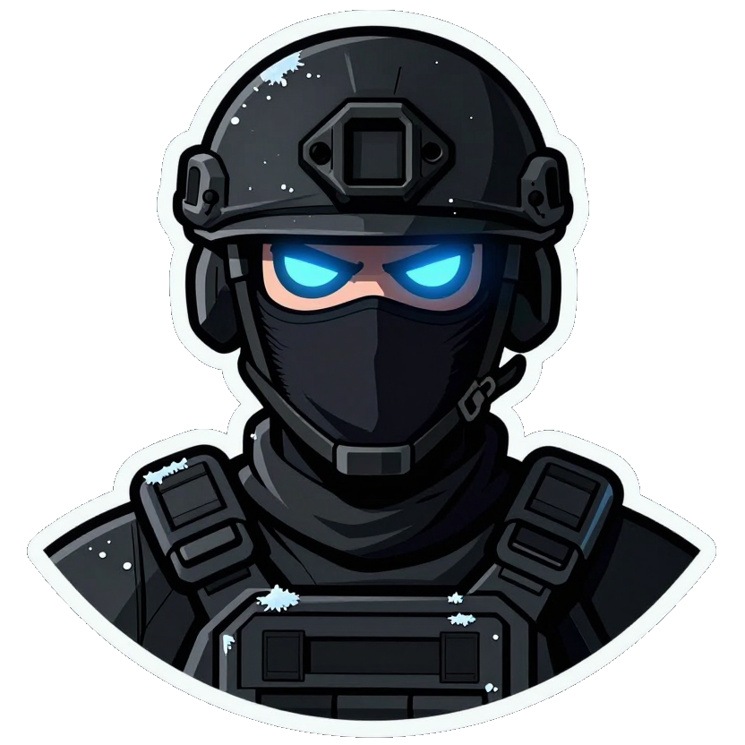
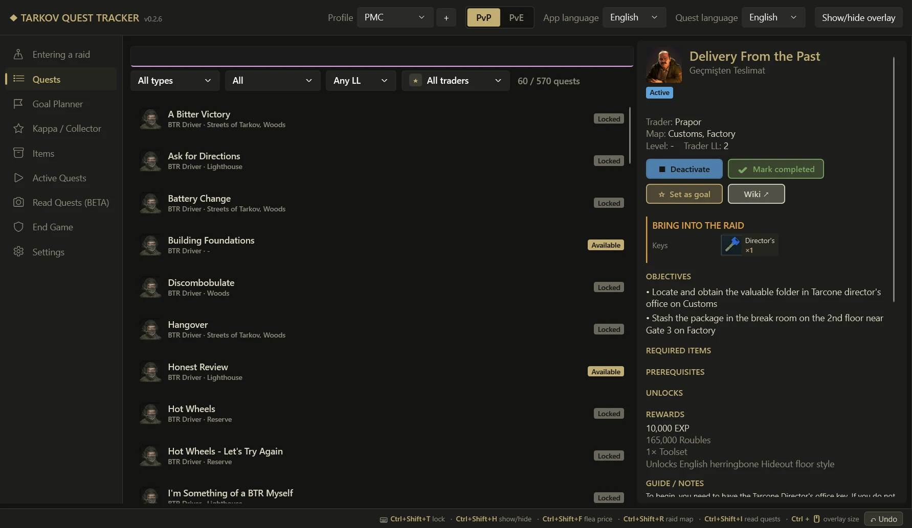
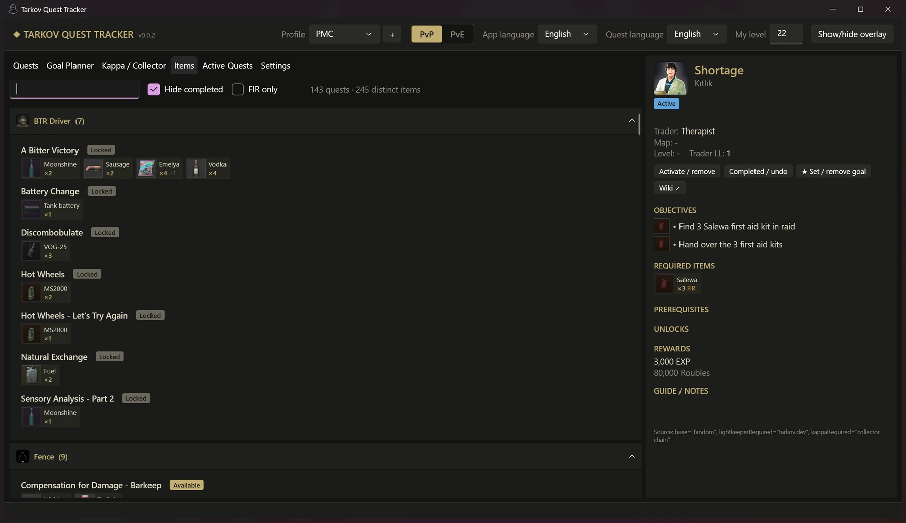
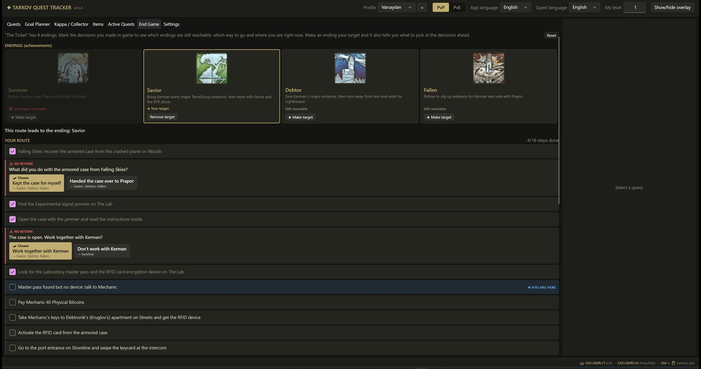
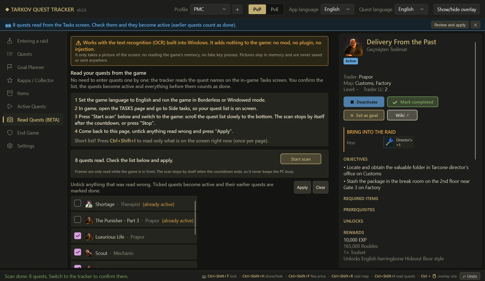
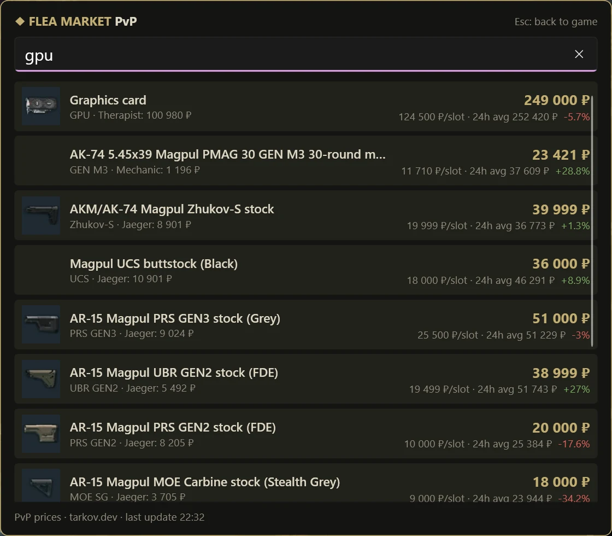
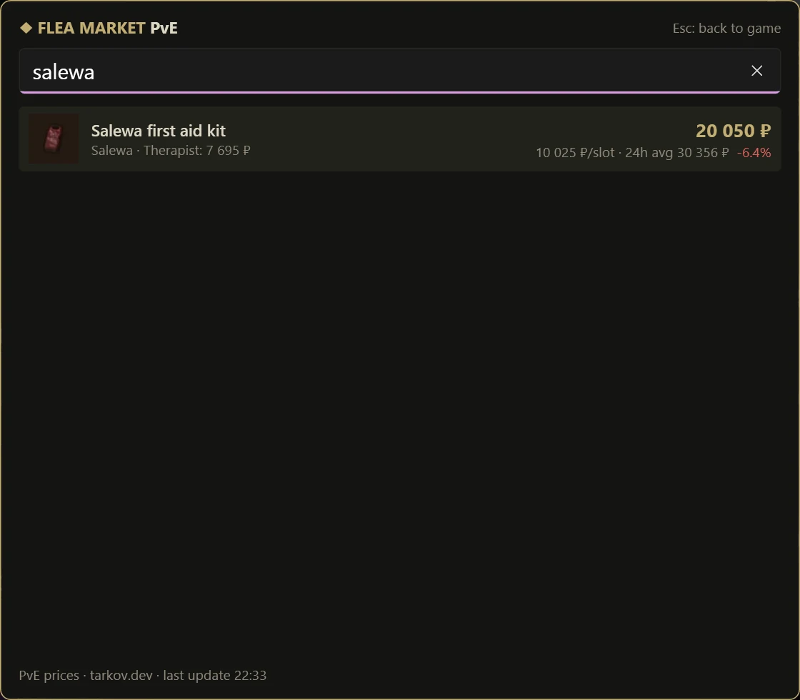
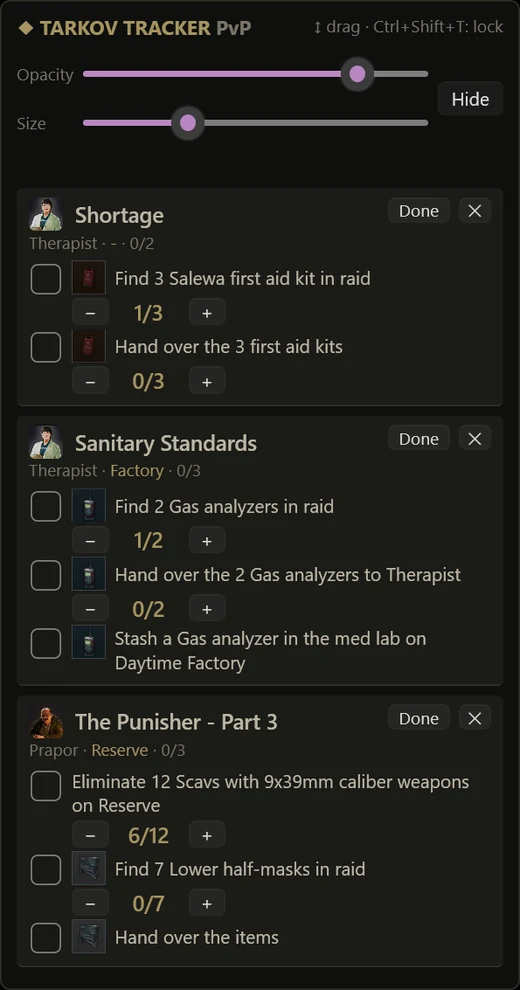

<p align="center">
  
</p>

<h1 align="center">EFT Quest Helper</h1>

<p align="center">
  <b>Escape from Tarkov</b> için masaüstü görev takip ve planlama uygulaması — her zaman üstte duran bir overlay ile.<br>
  <a href="README.md">English</a> · <b>Türkçe</b> · <a href="README.ru.md">Русский</a>
</p>

<p align="center">
  <a href="https://github.com/ugurturna/eft_quest_helper/releases/latest">
    
  </a><br>
  <a href="https://github.com/ugurturna/eft_quest_helper/releases/latest">https://github.com/ugurturna/eft_quest_helper/releases/latest</a><br>
  🌐 <b>Web Sitesi:</b> <a href="https://ugurturna.github.io/eft_quest_helper/">https://ugurturna.github.io/eft_quest_helper/</a>
</p>

---

## Ban riski

> [!TIP]
> **Bilinen bir ban riski yok.** EFT Quest Helper normal, ayrı bir Windows uygulamasıdır. Oyunun belleğini **okumaz ve değiştirmez**, oyuna hiçbir şey **enjekte etmez**, oyunun dosyalarını veya loglarını **okumaz**, oyuna tuş/fare girdisi **göndermez** ve oyunun sunucularıyla **konuşmaz**. Overlay, ekranın üstünde tutulan sıradan bir penceredir (yapışkan not gibi); kısayol tuşları Windows'un standart `RegisterHotKey` API'sini kullanır. **Görevleri Oku (BETA)** sadece ekranın görüntüsünü alır ve Windows'un kendi OCR'ı ile okur; görüntüler sadece bellekte kalır, kaydedilmez ve gönderilmez. **Otomatik raid algılama** da aynı şekilde çalışır: klavye hook'u yok, tuş okunmaz; oyun öndeyken sadece ekranın sağ üst köşesi okunur. **Harita ve konum** sadece senin aldığın ekran görüntülerinin **dosya adlarını** okur (oyun konumunu bu adlara yazar); görüntülerin kendisi hiç açılmaz.

> [!CAUTION]
> **Kullanım sorumluluğu sana aittir. Bu proje Battlestate Games ile bağlantılı değildir ve onlar tarafından onaylanmamıştır; BSG kurallarını her an değiştirebilir. BSG bir gün bu tür araçlara izin verilmediğini açıklarsa kullanmayı bırak.**

---

<p align="center">
  
</p>

## Özellikler

- **Tüm görevler tek yerde** — ~870 görev: trader (yan) görevleri, hikaye bölümleri ve event görevleri; hedefler, gerekli itemler, ödüller, rehber ve notlarla birlikte.
- **İkonlu görev itemleri** — hangi trader'ın hangi görev için hangi itemlere ihtiyacı olduğu; item ikonları, adetler ve Found-in-Raid (FIR) işaretleriyle (bkz. [Görev itemleri](#görev-itemleri)).
- **Ön koşul zincirleri** — her görev neye ihtiyaç duyduğunu ve neyi açtığını bilir.
- **Hedef planlayıcı** — bir hedef seç (ör. *The Punisher – Part 3* ya da *Collector*), tüm zinciri sırayla, şu an yapabildiklerini ve kalanları gör.
- **Kappa / Collector yolu** — Kappa için gerçekten gereken görevler: *Collector* ve tüm ön koşul zinciri. İlerleme çubuğu, yapılabilir görevler **haritaya göre gruplu** (aynı raidde birkaçını birden yap); her görevde gereken seviye yazar.
- **Aktif görevler + overlay** — yaptığın tüm görevler *Aktif Görevler*'de listelenir; ekranın sağ kenarındaki küçük takipçide sadece **📌 Overlay** ile sabitlediklerin görünür. Hedef kutucukları, öldürme/item sayaçları ve item ikonlarıyla. Görevi aktif yapmak onu overlay'e eklemez; overlay'de ne olacağına sen karar verirsin.
- **Oyun içinde flea fiyatları** — <kbd>Ctrl</kbd>+<kbd>Shift</kbd>+<kbd>F</kbd> ekranın ortasında fiyat araması açar; item'ın 3 harfini yaz, modundaki (PvP / PvE) flea fiyatını gör. [Flea market fiyatları](#flea-market-fiyatları) bölümüne bak.
- **Sol menü** — sayfalar (Raid'e giriyorum, Görevler, Hedef Planlayıcı, Kappa, Eşyalar, Aktif Görevler, Görevleri Oku (BETA), End Game, Ayarlar) soldaki menüde.
- **Görevleri oyundan oku (BETA)** — görevleri tek tek girmene gerek yok: oyundaki Tasks ekranını aç, bir kez kaydır; uygulama tüm görev adlarını Windows'un kendi OCR'ı ile okur. Listeyi onayla, görevler aktif olsun, onlardan önceki her şey tamamlandı sayılsın. [Görevleri oyundan oku](#görevleri-oyundan-oku-beta) bölümüne bak.
- **Raid'e ne götürmeli** — anahtarlar, markerlar (kaç tane gerektiğiyle), yerleştirilecek itemler, kullanılacak silah ve giyilecek kıyafet her görevin en üstünde ve *Aktif Görevler* kartında görünür.
- **Raid'e giriyorum** — sol menünün ilk maddesi: gireceğin haritayı seç (her harita için kaç aktif görevin olduğunu gösteren kartlar), overlay o haritadaki bütün aktif görevleri kendiliğinden göstersin, sabitlediklerin de kalsın. Birden çok haritalı görevlerde sadece o haritanın hedefleri görünür, "teslim et" adımları gizlenir. Oyunda <kbd>Ctrl</kbd>+<kbd>Shift</kbd>+<kbd>R</kbd> ile harita seçilir; **Raid bitti** sabitlenmiş listeye döner. Raid başlayınca kilidi açık overlay kendiliğinden kilitlenir, tıklamalar oyuna gider. **Otomatik algıla** açıksa raid'de çift <kbd>O</kbd> yeter: map ve kalan raid süresi exfil listesinden okunur (bkz. [Otomatik raid algılama](#otomatik-raid-algılama-çift-o)).
- **Teslim edince sonraki görevler kabul edilir** — aktif bir görevi tamamla, açtığı görevler aktif olsun (overlay'e eklenmez: trader'dan almayı yine sen yaparsın).
- **Bir görevi aktif yapmak zincirini tamamlar** — *Punisher Part 5*'i aktif yap, Part 1–4 otomatik tamamlandı sayılsın (tek tıkla geri alınabilir).
- **PvP ve PvE** — her mod için ayrı ilerleme; PvE'ye özel farklar (seviye, hedefler, itemler) gösterilir.
- **İngilizce ve Türkçe arama** — yazım hatalarına ve Türkçe karakterlere toleranslı (`punisher 3`, `punişır 3`, `cezalandırıcı`).
- **İki ayrı dil** — uygulama dili (menüler) ve görev dili (görev ve item adları) farklı olabilir; ör. uygulama Türkçe, görevler İngilizce. Tüm hikaye bölümleri Türkçeye çevrildi.
- **Profiller** — aynı bilgisayarda birden fazla oyuncu, herkesin kendi ilerlemesi ve ayarları.
- **Event görevleri** — aktif eventler listelenir; artık yapılamayan geçmiş eventler gösterilmez.
- **Haritada konumun** — raidde kendi ekran görüntüsü tuşunla ekran görüntüsü al; harita penceresi nerede olduğunu ve nereye baktığını, önceki ekran görüntülerinden izini, exfilleri ve aktif görevlerinin noktalarını gösterir; kat yüksekliğine göre değişir. Bkz. [Harita ve konum](#harita-ve-konum-ekran-görüntüleri).
- **End Game (The Ticket sonları)** — 4 sondan hangilerine hâlâ ulaşabileceğin, hedef sonuna giden yol ve şu an nerede olduğun ([End Game](#end-game-the-ticket-sonları) bölümüne bak).
- **Hızlı** — listeler kaydırdıkça sayfa sayfa yüklenir.

### Görev itemleri

<p align="center">
  
</p>

**Eşyalar** sekmesi "görevlerim için neleri saklamalıyım?" sorusunu cevaplar:

- Önce **trader'a**, sonra **göreve** göre gruplu; her item küçük bir kart: **ikonu**, kısa adı, **adedi** ve raid'de bulunması gerekiyorsa **FIR** işareti. Tam adı görmek için kartın üstüne gel.
- Birden fazla item kabul eden hedeflerde (ör. *herhangi 3 tıbbi item*) ilk item ve **+N** gösterilir; açılan kutuda alternatifler listelenir.
- Bir item **arat** (`Salewa`, `GPU`, `Tushonka`…), onu isteyen tüm görevleri gör.
- **Bitenleri gizle** (varsayılan açık) ve **Sadece FIR** filtreleri; üstte kaç görev ve kaç farklı item kaldığı yazar.
- Görev adına tıklayınca detay panelinde açılır.

Item ikonları **görevlerin içinde de** görünür: bulma / teslim / yerleştirme hedefleri; görev detayında, *Aktif Görevler* kartlarında ve overlay'de item'ın ikonunu gösterir. Detay paneli de görevin gerekli itemlerini kart olarak listeler. Itemler görev dilinde (İngilizce veya Türkçe) gösterilir.

### End Game (The Ticket sonları)

<p align="center">
  
</p>

**The Ticket** hikaye bölümünün 4 sonu var: **Survivor**, **Savior**, **Debtor** ve **Fallen**. Geri dönüşü olmayan 3 karar da var: zırhlı çantayla ne yaptığın, Kerman'la çalışıp çalışmadığın ve TerraGroup kanıtlarında ona ne kadar yardım ettiğin. **End Game** sekmesi bunu senin için planlar:

1. **Aç** — *End Game* sekmesi ya da *Hedef Planlayıcı*'da *The Ticket*'ı hedef yap: rehberin tamamı görev zincirinin altında çıkar. *The Ticket*'ın detay panelinde de **🎫 End Game rehberi** butonu var.
2. **Kararlarını işaretle** — oyunda verdiğin kararlara tıkla (geri almak için tekrar tıkla). Her seçenek hangi sonları açık tuttuğunu gösterir, ör. *Kerman'la çalışma → Survivor*.
3. **Hedef sonunu seç** — bir son kartında **★ Hedef yap**'a bas (her kartta o sonun başarım resmi var). Önündeki kararlarda **★ Hedefin için bunu seç** işareti çıkar; kararların o sonu zaten kapattıysa uyarı ve hâlâ ulaşabileceğin sonlar gösterilir.
4. **Yolu takip et** — her adım sırayla ve işaret kutusuyla: görevler, yoldaki başarımlar (*Easy Way*, *U Turn*, *Enough of Your Games!*, *Will It Blow*, isteğe bağlı *I Am Speed* ve 36 küçük kanıtın hepsi için *Little Triumph*), uyarılar (BTR / Skier, 72 saat sınırı, her ses kaydını dinle) ve kaçış kuralları (Shoreline 21:00–06:00, elinde silah olmadan, kaçış başarısız olursa ne yapılır). **◀ ŞU AN BURADASIN** sıradaki adımı gösterir.

- Önceki seçimlere bağlı adımlar onlarla birlikte değişir: ör. çantayı Prapor'a verdiysen 300M, sakladıysan 500M ruble ister.
- **PvP ve PvE** hedefleri farklıdır (Co-Op çıkışları yerine Scav öldürmeden 5 PMC); rehber senin modununkini gösterir.
- Seçimler, hedef ve işaretlenen adımlar ilerlemenle birlikte, profil ve mod başına kaydedilir. **Sıfırla** hepsini temizler.
- Yol verisi `data/ticket_endings.json` dosyasında (İngilizce ve Türkçe) ve topluluğun *Story Endings* akış şeması v1.7.6'yı (Callsign_Smokey / Kay08x) takip eder.

### Görevleri oyundan oku (BETA)

<p align="center">
  
</p>

> [!NOTE]
> Windows'un kendi yazı tanıma (OCR) özelliğiyle çalışır. **Oyuna herhangi bir eklenti, mod veya müdahale yapmaz.** Sadece ekranın görüntüsünü alır; oyunun belleğini okumaz, senin yerine tuşa basmaz. Görüntüler sadece bellekte kalır, kaydedilmez ve hiçbir yere gönderilmez.

1. Oyun dilini **İngilizce** yap, oyunu **Borderless** veya **Windowed** modda çalıştır (görev adları İngilizce adlarla eşleştirilir).
2. Oyun içinden **TASKS** sayfasını aç ve **Side tasks** bölümüne gel.
3. **Görevleri Oku (BETA)** sayfasında **Taramayı başlat**'a bas ve oyuna geç. Görev listesini yavaşça en alta kaydır: yaklaşık 0,7 sn'de bir kare okunur, tarama **30 saniye sonra kendiliğinden durur** (kalan süre geri sayımla görünür), bilgisayarı boşuna yormaz. Liste kısa mı? <kbd>Ctrl</kbd>+<kbd>Shift</kbd>+<kbd>I</kbd> sadece o an ekranda görüneni okur.
4. Uygulamaya dön, yanlış okunanların işaretini kaldır ve **Uygula**'ya bas. İşaretli görevler aktif olur, önceki görevleri tamamlandı sayılır; **Geri al** hepsini geri çevirir. Zaten aktif olanlar belirtilir ve işaretsiz gelir.

### Otomatik raid algılama (çift O)

Raid'de <kbd>O</kbd>'ya iki kez bas: oyun exfillerini sağ üstte listeler, takipçi de isimlerinden map'i tanır. **Raid'e giriyorum** sayfasının en üstündeki anahtar bunu **Açık** / **Kapalı** yapar (varsayılan: açık).

- **Listenin yüklenmesini bekler.** Her PC listeyi bir anda çizmez: ilk exfiller görününce köşe yeni exfil gelmeyene kadar tekrar okunur (en fazla ~3 sn), map ancak ondan sonra belirlenir.
- **Raid süresi.** Exfillerin üstündeki kalan süre de okunur; overlay ve raid bandı geri sayar (⏱ 32:10), süre bitince raid kendiliğinden kapanır. **Tek** <kbd>O</kbd> (sadece saat) devam eden raid'in süresini düzeltir. Rakamlar oyunun kendi fontundaki şekillerinden okunur (Windows OCR o saati okuyamıyor) ve süre ancak iki okuma aynı çıkarsa alınır; yanlış okunan bir rakam raid'i erken kapatamaz.
- **FPS sayacı açık mı?** Koyu kutusunun altında kalan saat yine okunur (ikinci, düşük ışıklı bir geçiş yeşil / kırmızı FPS yazısını yok sayar); yazısı saniyelerin üstüne biniyorsa süre dakikasına kadar okunur (±30 sn). Okunamayan bir rakam süre yok demektir, asla tahmin edilmez.
- **Raid'i baştan başlatmaz.** Zaten o map'te raid'desin? Çift <kbd>O</kbd> sadece süreyi düzeltir. Başka bir map'in listesi görünürse raid orada başlar.
- **Boş ekranda hata yok.** Köşede exfil listesi yoksa raid'de değilsin (ya da liste kapalı) demektir: hiçbir şey olmaz.
- **Temkinli.** Sadece o map'te olan bir exfil, büyük map'lerde de toplam iki exfil ister; emin değilse bir şey yapmaz. Exfil isimleri tarkov.dev'den gelir (`tools/scraper/fetch_extracts.py` → `data/extracts.json`).
- **Gerekenler:** oyun **Borderless** veya **Pencereli** modda, ve Windows'un İngilizce metin tanıma paketi. Overlay **sağ üst köşede kalabilir**: otomatik algılama açıkken ekran görüntülerinden çıkarılır (Windows display affinity), altındaki exfil listesi yine okunur. Sen onu her zamanki gibi görürsün; sadece kayıtlarda, yayında ve ekran görüntülerinde görünmez.

> [!NOTE]
> Klavye hook'u yok, tuş okunmaz, oyuna hiçbir şey gönderilmez. Oyun öndeyken sadece ekranın sağ üst köşesi Windows'un kendi OCR'ı ile ara ara okunur; görüntü bellekte kalır, kaydedilmez ve gönderilmez.

### Harita ve konum (ekran görüntüleri)

Raidde ekran görüntüsü aldığında oyun konumunu dosya adına yazar (`2026-11-09[15-01]_200.5, 1.2, 150.3_…png`: X, yükseklik, Z ve baktığın yön). Takipçi ekran görüntüsü klasörünü izler ve seni haritada gösterir:

- **Hangi tuş olursa olsun.** Uygulama tuşu değil klasörü izler: oyunda ekran görüntüsü için hangi tuşu atadıysan o çalışır. Ek bir kısayol yok.
- **Kendiliğinden açılır.** Yeni bir ekran görüntüsü harita penceresini oyunun odağını almadan açar (**Ayarlar → Harita ve konum**'dan kapatılabilir; overlay'deki ve Ayarlar'daki **🗺 Harita** butonu da açar). Başlığından sürükleyip taşı, köşesinden boyutlandır; yeri ve boyutu hatırlanır.
- **Neler var:** nerede olduğunu ve nereye baktığını gösteren kırmızı ok, bu raiddeki ekran görüntülerinden kesikli iz, exfiller (PMC / Scav / ortak, transitler) ve **aktif** görevlerinin hedef noktaları (üstüne gelince görev yazar; tamamlanan hedefler kaybolur).
- **Katlar.** Kat yüksekliğine göre seçilir (ör. Customs yurtlarının 2. katı); istersen listeden elle seç.
- **Raidi takip eder.** Harita raidin haritasını takip eder (seçilen ya da çift <kbd>O</kbd> ile bulunan); raid yoksa haritayı pencereden seç. Tekerlek yakınlaştırır, sürüklemek etrafa bakar, **◎** tekrar seni ortalar, **⟳** son ekran görüntüsünü yeniden okur.
- **Harita görselleri** tarkov.dev'in haritalarıdır (vektör haritalar, vektörü olmayanlarda uydu görüntüsü); bir harita ilk açıldığında indirilir ve diskte saklanır, sonra internetsiz de çalışır. Exfil ve görev noktalarının konumları tarkov.dev'den gelir (`tools/scraper/fetch_maps.py` → `data/maps.json`).
- Klasör `Belgeler\Escape from Tarkov\Screenshots`; başka bir klasör **Ayarlar → Harita ve konum**'dan seçilebilir.

> [!NOTE]
> Sadece ekran görüntülerinin **dosya adları** okunur; görüntüler hiç açılmaz, oyuna hiçbir şey gönderilmez.

### Flea market fiyatları

<p align="center">
  
  
</p>

Oyundayken bir item'ın kaça gittiğini görmek için tarayıcıya alt-tab yapmadan <kbd>Ctrl</kbd>+<kbd>Shift</kbd>+<kbd>F</kbd>:

- **Ekranın tam ortasında** açılır ve klavyeyi alır; **<kbd>Esc</kbd> kapatır ve seni oyuna geri döndürür**.
- **3 harf** yazınca sonuçlar gelir; İngilizce ya da Türkçe (`gpu`, `ledx`, `salewa`, `ekran kartı`).
- Fiyatlar **oyun moduna** göredir: PvP ve PvE flea fiyatları farklıdır, pencere seçtiğin modu gösterir.
- Her item için: **flea fiyatı** (en düşük teklif, satan yoksa 24 saatlik ortalama), büyük itemlerde **slot başı fiyat**, **24s ortalama**, **48 saatlik değişim**, satılabilecek **en iyi trader** ve flea'da satılamayanlar için *Flea'da satılamaz*.
- Fiyatlar [tarkov.dev](https://tarkov.dev)'den gelir (`json.tarkov.dev/regular/items` ve `/pve/items`). Uygulama açılınca oynadığın mod arka planda indirilir (diğeri o modda arama açınca) ve zaman damgasıyla diske kaydedilir; aramayı açtığında **15 dakikadan** eskiyse senin modun yeniden indirilir, bu sırada kayıtlı kopyada aramaya devam edersin. Arama asla internet beklemez.

### Overlay



- Sağ kenarda başlar; **başlıktan sürükleyerek ekranda istediğin yere taşıyabilirsin** (ya da Ayarlar'daki konum kaydırıcıları).
- Ayarlanabilir **opaklık**, **boyut** (%60–200, ayrıca <kbd>Ctrl</kbd> + fare tekerleği) ve **genişlik**.
- İki görünüm: **sadece başlık** ya da **başlık + detay**.
- Item hedeflerinde **item ikonu** görünür; raid ortasında loot'u bir bakışta tanırsın.
- <kbd>Ctrl</kbd>+<kbd>Shift</kbd>+<kbd>T</kbd> — overlay'i kilitle (tıklamalar oyuna geçer) / aç.
- <kbd>Ctrl</kbd>+<kbd>Shift</kbd>+<kbd>H</kbd> — overlay'i göster / gizle.
- Sadece **📌 Overlay** ile sabitlenen görevleri gösterir (70 aktif görevin olsa bile). *Aktif Görevler*'den sabitle / kaldır; overlay'deki ✕ sadece overlay'den kaldırır, görev aktif kalır.
- Oyundan odağı asla çalmaz.

> [!NOTE]
> Tarkov'u **Borderless (Çerçevesiz)** ya da **Windowed (Pencere)** modda çalıştır. Windows, tam ekran (exclusive fullscreen) bir oyunun üstüne başka pencere çizemez.

<br clear="right">

## Kısayollar

| Kısayol | Ne yapar |
|---|---|
| <kbd>Ctrl</kbd>+<kbd>Shift</kbd>+<kbd>T</kbd> | **Overlay'i kilitle / kilidi aç.** Kilitliyken overlay'e tıklanamaz, tüm tıklamalar oyuna geçer; oynarken kilitli bırak. Ayar yapmak ya da taşımak için kilidi aç. |
| <kbd>Ctrl</kbd>+<kbd>Shift</kbd>+<kbd>H</kbd> | **Overlay'i göster / gizle**, ör. raid ortasında ekranı temizlemek için. |
| <kbd>Ctrl</kbd>+<kbd>Shift</kbd>+<kbd>F</kbd> | Ekranın ortasında **flea market fiyat araması**, modundaki (PvP / PvE) fiyatlarla. <kbd>Esc</kbd> kapatır ve oyuna döner. |
| <kbd>Ctrl</kbd>+<kbd>Shift</kbd>+<kbd>R</kbd> | **Raid'e giriyorum**: overlay'de harita listesi açılır (tıklayabilmen için kilidi açılır); haritayı seç, overlay o haritanın aktif görevlerini göstersin. Tekrar basınca kapanır. |
| <kbd>Ctrl</kbd>+<kbd>Shift</kbd>+<kbd>I</kbd> | **Görevleri oku (BETA)**: oyunda o an açık olan Tasks ekranındaki görev adlarını (bir kez) okur. *Görevleri Oku (BETA)* sayfasında kontrol edip uygula. |
| <kbd>Ctrl</kbd> + fare tekerleği | Fare (kilidi açık) overlay'in üstündeyken: **büyüt / küçült** (%60–200). |
| Overlay başlığını sürükle | **Overlay'i ekranda istediğin yere taşı** (sadece kilit açıkken). |

- Kısayollar oyun açıkken ve uygulama arka plandayken de çalışır.
- Overlay'deki ipucu oyunda zor okunabildiği için kısayollar ana pencerenin alt çubuğunda hep görünür, **Ayarlar**'ın en üstünde de açıklamalı olarak yazar.
- Değiştirmek için profilin `settings.json` dosyasında `clickThroughHotkey` / `toggleOverlayHotkey` / `fleaSearchHotkey` / `raidHotkey` (ör. `"Ctrl+Alt+F9"`). Kısayol başka bir program tarafından kullanılıyorsa uygulama açılışta söyler.

## İndir & çalıştır

**Son sürümü indir (önerilen):** [Sürümler](https://github.com/ugurturna/eft_quest_helper/releases/latest) → `TarkovQuestTracker-vX.Y.Z-win-x64.zip`

Zip'i istediğin yere çıkar ve `TarkovQuestTracker.exe`'yi çalıştır. Kurulum yok, .NET içinde geliyor. `data` klasörünü exe'nin yanında tut; görev verisi, item ikonları ve ilerlemen orada.

### "Windows bilgisayarınızı korudu" uyarısı

Exe henüz kod imzalı değil, bu yüzden ilk çalıştırmada Microsoft Defender SmartScreen **"Windows bilgisayarınızı korudu — Bilinmeyen yayımcı"** uyarısı gösterebilir. Yeni ve imzasız açık kaynak uygulamalarda bu normaldir; uygulamayı kullanan kişi sayısı arttıkça kaybolur.

> [!IMPORTANT]
> **Her sürüm, zararlı yazılım analizi için Microsoft'a gönderilir.** Microsoft'un incelemesi **3–5 iş günü** sürer; bu yüzden yeni çıkan bir sürüm, inceleme bitene kadar bu uyarıyı gösterebilir.

Yine de çalıştırmak için: **Ek bilgi** → **Yine de çalıştır**.

Önce kontrol etmek istersen: kaynak kodun tamamı bu repoda ve her sürüm, etiketlenmiş bir commit'ten [GitHub Actions](.github/workflows/release.yml) ile derlenir. Çalıştırmadan önce zip'i [VirusTotal](https://www.virustotal.com/)'da da taratabilirsin.

### Güncelleme

**Otomatik (v0.1.2'den sonraki sürümden itibaren):** yeni sürüm çıkınca ana pencerenin üstünde bir bant çıkar. **Güncelle**'ye bas: uygulama release zip'ini GitHub'dan indirir, release'in SHA-256 özetiyle doğrular, kendi dosyalarını değiştirir ve yeniden başlar. `data\profiles` (ilerleme, ayarlar) ve flea fiyat önbelleğine asla dokunulmaz. Açılıştaki kontrolü kapatmak ya da elle kontrol etmek için **Ayarlar → Güncellemeler**.

**Elle (ya da v0.1.2 ve öncesinden):** ilerlemen exe'nin yanındaki `data\profiles` klasöründe. Yeni sürümü ayrı bir klasöre çıkarıp `data\profiles`'ı oraya kopyala ya da eski sürümde **Ayarlar → Dışa aktar**, yenisinde **İçe aktar** kullan.

## İlerlemem nerede saklanıyor?

Her şey bilgisayarında saklanır, hiçbir yere yüklenmez. Exe'nin yanında `data` klasörü varsa (release zip'i, publish ya da derlenmiş uygulama) orası kullanılır:

```
data\
  app.json                      son kullanılan profil
  profiles\<ad>\settings.json   overlay, diller, kısayollar
  profiles\<ad>\progress_pvp.json
  profiles\<ad>\progress_pve.json
  maps\                         tarkov.dev'den indirilen harita görselleri
```

Exe'nin yanında `data` klasörü yoksa aynı dosyalar `%APPDATA%\TarkovQuestTracker\` altına yazılır. Başka bir yerde tutmak için `TARKOV_TRACKER_HOME` ortam değişkenini ayarla.

İlerleme her tıklamada kaydedilir. Yedeklemek ya da başka bilgisayara taşımak için **Ayarlar → Dışa / İçe aktar**'ı kullan.

Kısayollar `settings.json` içinden değiştirilebilir (`clickThroughHotkey`, `toggleOverlayHotkey`, `fleaSearchHotkey`, `raidHotkey`, ör. `"Ctrl+Alt+F9"`).

## Kaynaklar & yasal

- Görev verisi: [Escape from Tarkov Wiki (Fandom)](https://escapefromtarkov.fandom.com/) — içerik [CC BY-SA 3.0](https://creativecommons.org/licenses/by-sa/3.0/) lisansıyla — ve [tarkov.dev](https://tarkov.dev/) (görev itemleri ve item ikonları; harita penceresi için haritalar, exfiller ve görev noktaları).
- *Escape from Tarkov*, trader adları, trader portreleri ve item görselleri **Battlestate Games**'in markası/mülküdür. Burada sadece oyun içi içeriği tanımlamak için kullanılmıştır. Bu ticari olmayan bir hayran projesidir.
- Free code signing provided by [SignPath.io](https://signpath.io), certificate by [SignPath Foundation](https://signpath.org).
- [MIT Lisansı](LICENSE) altında lisanslanmıştır.
